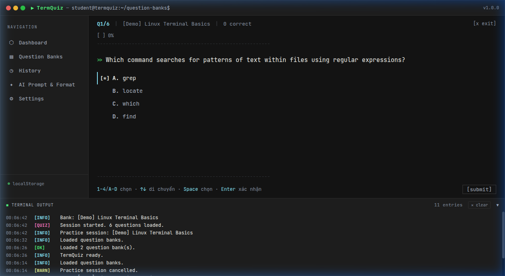
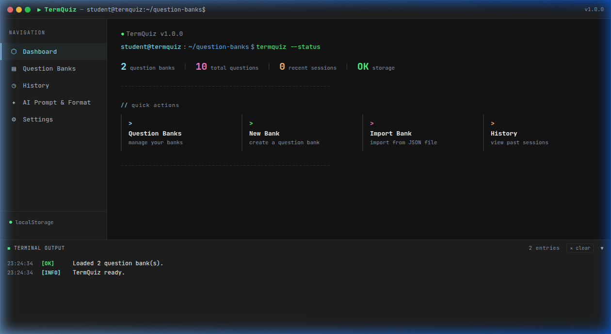
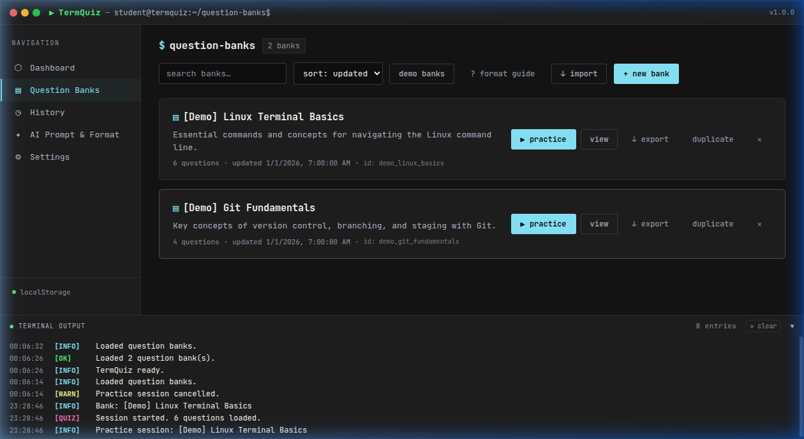
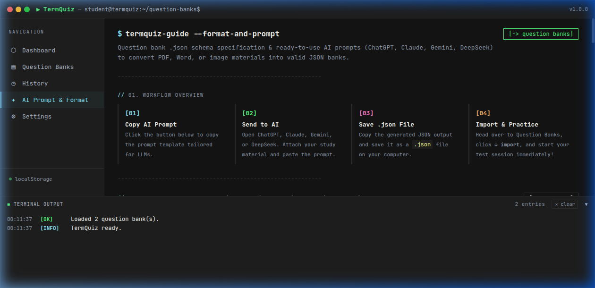

# TermQuiz

A distraction-free, terminal-styled multiple choice quiz app built for fast studying. Run it locally in your browser with zero tracking, no accounts, and complete offline support.

👉 **[Live Demo on GitHub Pages](https://linhcbs.github.io/TermQuiz/)**



---

## Why TermQuiz?

Most quiz websites are cluttered with ads, paywalls, or slow UI. TermQuiz keeps things simple:

- **Keyboard-first workflow:** Answer with `1-4` or `A-D`, navigate with arrow keys, and submit with `Enter`. You never have to touch your mouse.
- **100% Offline & Private:** All question banks and practice records live in your browser's local storage.
- **Randomized quizzes:** Questions and answer options shuffle every run to stop you from memorizing option positions.
- **AI-friendly import:** Got a study guide in PDF, Word, or image format? Use our prompt template with ChatGPT, Claude, Gemini, or DeepSeek to generate a ready-to-import `.json` file in seconds.



---

## Getting Started (Beginner Friendly)

If you have never used GitHub or the command line before, follow these simple steps to get the app running on your computer.

### Step 1: Install Node.js
TermQuiz requires **Node.js** to run locally.
1. Go to [nodejs.org](https://nodejs.org/).
2. Download the recommended **LTS** version.
3. Run the installer and click **Next** through the setup with default settings.

### Step 2: Download the Project
1. Scroll to the top of this GitHub page.
2. Click the green **Code** button, then select **Download ZIP**.
3. Once downloaded, extract (unzip) the ZIP file to a folder on your computer (for example, on your Desktop or in Documents).

### Step 3: Open the Terminal in the Project Folder

- **On Windows:**
  1. Open the extracted folder and double-click into `term-quiz` (or `term-quiz-main`).
  2. Click the file path bar at the top of File Explorer, type `cmd`, and press **Enter**. A black Command Prompt window will open right inside the folder.
- **On macOS:**
  1. Open the extracted folder in Finder.
  2. Right-click the folder, go to **Services**, and select **New Terminal at Folder** (or open the Terminal app, type `cd ` with a space, and drag the folder into the window).
- **On Linux:**
  1. Right-click inside the folder and select **Open in Terminal**.

### Step 4: Run the App

In your terminal window, run the following commands one by one:

1. **Move into the app directory:**
   ```bash
   cd term-quiz-app
   ```

2. **Install dependencies (only needed the first time):**
   ```bash
   npm install
   ```
   *(Wait a few seconds for the packages to download).*

3. **Start the app:**
   ```bash
   npm run dev
   ```

4. You will see a link like `http://localhost:5173`. Hold `Ctrl` (or `Cmd` on Mac) and click the link, or copy and paste it into Chrome, Edge, Safari, or Firefox.

> **Tip for next time:** Whenever you want to study again, just open the terminal in `term-quiz-app` and type `npm run dev`. To stop the app, press `Ctrl + C` in the terminal.

---

## Quick Guide

### 1. Adding Questions



You have three options:
- **Demo Banks:** Click `demo banks` under the **Question Banks** tab to load sample questions and try out the app.
- **Manual Entry:** Click `+ new bank` to type questions and answers by hand.
- **Convert Study Guides with AI (Fastest):**
  1. Open the **✦ AI Prompt & Format** tab in the sidebar.
  2. Click `[copy prompt]`.
  3. Paste the prompt into ChatGPT, Claude, Gemini, or DeepSeek alongside your study guide (PDF, Word doc, or photos of your textbook/notes).
  4. Save the generated JSON response into a `.json` file.
  5. Go to **Question Banks**, click `↓ import`, and pick your file.



### 2. Taking a Quiz

1. Click `▶ practice` on any question bank.
2. Answer questions using your keyboard:
   - `1` – `4` or `A` – `D`: Select an answer option directly.
   - `↑` / `↓`: Move the selection cursor up or down.
   - `Enter`: Submit your answer (press again to proceed to the next question).
3. Immediate feedback reveals the correct answer and explanation as soon as you submit.

### 3. Reviewing Mistakes

- Once a session ends, check your accuracy rate, score, and total time.
- Filter by **Incorrect Only** to review missed questions and read explanations.
- Past attempts are saved under the **History** tab so you can track your progress.

---

## Keyboard Shortcuts

| Shortcut | Action |
|---|---|
| `↑` / `↓` (Main pages) | Switch between sidebar tabs |
| `1`, `2`, `3`, `4` or `A`, `B`, `C`, `D` | Pick answer option |
| `↑` / `↓` (During quiz) | Move answer cursor |
| `Space` | Select current option under cursor |
| `Enter` | Submit answer / Advance to next question |

---

## Sharing with Friends

Click `↓ export` on any question bank to download its `.json` file. You can send it to your classmates so they can import it into their own TermQuiz instance and practice the same questions.
